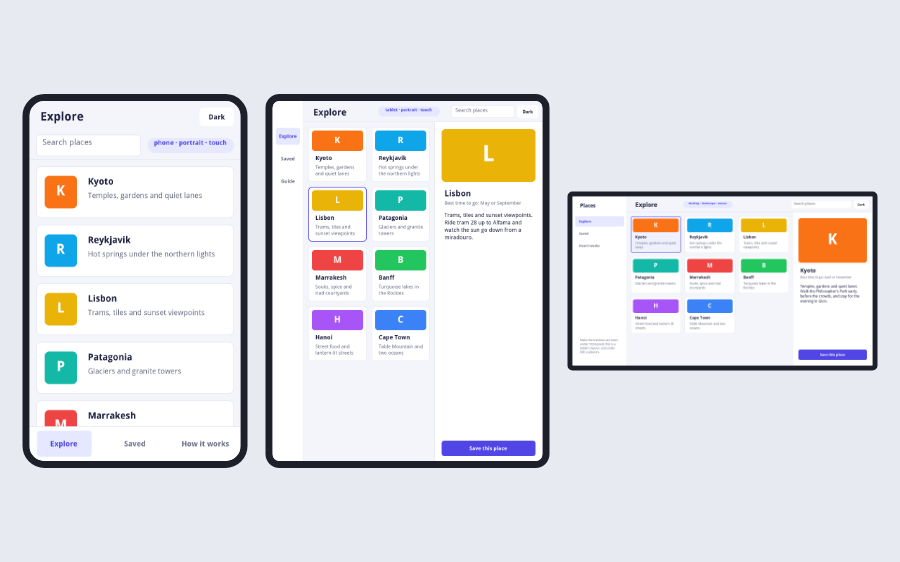

# Stacks for Every Screen

## Introduction

One HTML5 standalone is opened on a phone in someone's hand, on a tablet
on the sofa and in a wide window on a desktop. A web page meets that by
changing its layout at a few widths, its *breakpoints*: a tab bar at the
bottom of a phone, a rail down the side of a tablet, a sidebar on a
desktop, and a grid with one, two or three columns. The Mobile Web
library does the same for a stack, in xTalk.

There are two ways to say what goes where, and a stack can use both:

* **Rules**, kept in each control's `mwLayout` custom properties: "on a
  phone, the tabs are a bar at the bottom 64 pixels high; on a desktop, a
  sidebar 232 pixels wide". The library follows them each time the stack's
  size changes, in the IDE as in a browser, with no code.
* **Messages**: the card gets `layoutChanged` when the stack crosses from
  one layout to another, for whatever the rules cannot say.



Figure 1 – The Responsive Starter on a phone, a tablet and a desktop: one
stack, the same controls

This guide goes with *Stacks for Phones*, which covers filling a
phone's screen, touch, the keyboard and the phone's own sensors. The
handlers here are in OXT-Beyond 0.2.7-rc.6.16 and later.

## Start from the Responsive Starter

The quickest way in is the **Responsive Starter**, in the gallery of the
Home window and in the Stack Player. It is a small app, *Places*, made to
be copied:

* **Explore**: a grid of places that reflows into one, two or three
  columns, with a search that keeps the places that match.
* **Saved**: the places saved, in the same grid.
* **How it works**: what this guide says, in short, and a live panel of
  the layout now and the rules the library is following.

Pick a place and its details open beside the grid on a tablet or a
desktop, and as a sheet over it on a phone. A badge at the top says the
layout, the orientation and the pointer as the library sees them. A
**Dark** button switches the look, which starts as the browser's or the
computer's.

Open it in the IDE and make its window narrower and wider, and the
layout changes at 1024 and at 600 pixels. Build it for HTML5 and open it
on a phone, and it fills the screen, stays out of the notch, and turns.

Everything it does is in two places: the rules on its controls, which
the builder `tools/web-player/responsive-starter.livecodescript` sets,
and the stack's script, about 700 lines, which does the rest.

## Two lines when the stack opens

```
on preOpenStack
   mwStart
   mwResponsive
end preOpenStack
```

`mwStart` makes the stack fill a phone's screen (see *Stacks for
Phones*); on a desktop it changes nothing. `mwResponsive` lays the stack
out for its size now, and again each time it changes. Make the stack
**resizable**: a stack of a fixed size is never resized, so it keeps one
layout.

The library learns of a size change from `resizeStack`, so a stack's own
`resizeStack` handler must `pass` it, as for the Geometry Manager.

## Phone, tablet or desktop

`mwLayoutClass()` names the layout for the stack's width:

| Width | Class | Usually |
|-------|-------|---------|
| under 600 | `phone` | a phone held upright |
| 600 to 1023 | `tablet` | a tablet, or a phone on its side |
| 1024 and over | `desktop` | a computer's window, or a big tablet on its side |

It goes by the width alone, the way a web page's breakpoints do, so a
window on a desktop made narrow gets a phone's layout, which is what that
window needs. `mwLayoutClass(700)` answers for a width, and
`mwLayoutClass("My Stack")` for a stack.

To change the widths, for a stack whose desktop layout needs more room:

```
mwSetBreakpoints 600, 1200
```

`mwBreakpoints()` gives them back, and `mwSetBreakpoints` alone returns
them to 600 and 1024. The stacks being laid out are laid out again at
once.

## Rules on the controls

A rule is a custom property of the `mwLayout` set, under the name of a
layout:

```
set the mwLayout["phone"] of group "Nav" to "left 0, right 0, bottom 0, height 64"
set the mwLayout["tablet"] of group "Nav" to "left 0, top 0, bottom 0, width 88"
set the mwLayout["desktop"] of group "Nav" to "left 0, top 0, bottom 0, width 232"
```

Those three lines are the Responsive Starter's tabs: a tab bar, a rail
and a sidebar. The names a rule can have, from the most particular:

* `phone landscape`, `tablet portrait` and so on: a class and an
  orientation
* `phone`, `tablet`, `desktop`: a class
* `all`: every layout

The library takes the most particular one the control has, so `all`
gives a default and `phone` a change for phones only. A control with no
rule that fits is left where it is: a stack can give rules to a few
controls and lay out the others in its own `resizeStack`.

What a rule can say, separated by commas:

| Words | What they do |
|-------|--------------|
| `left N`, `top N`, `right N`, `bottom N` | the distance from that edge of the card; N is pixels, or a percentage of the card (`right 40%`) |
| `width N`, `height N` | the size, when it does not follow from two edges |
| `hidden` | hidden in this layout, and shown again in a layout whose rule does not say so; a control a script hid stays hidden |
| `within` | measured from the group the control is in, not from the card |
| `bleed` | an edge at 0 reaches past a phone's notch or home bar to the edge of the screen |
| `flow N`, `gap N` | for a group: its controls in N columns, `gap` pixels apart (`flow` alone is 1, 2 or 3 by the class) |

A group placed by a rule takes its controls with it, and keeps the
rectangle it is given. The controls in it can then have rules of their
own, with `within`, so a panel lays itself out wherever it goes:

```
set the mwLayout["all"] of field "Title" to "within, left 16, right 16, top 12, height 32"
```

### Out of the notch

On a phone with a notch, the distances are measured from inside the safe
area, so a bar with `top 0` sits below the notch. Its background, given
`bleed`, fills the notch as well, and the bar looks as if it reaches the
top of the screen while its title stays clear:

```
set the mwLayout["all"] of graphic "Top Back" to "within, left 0, top 0, right 0, bottom 0, bleed"
```

On a desktop, and in a browser without a notch, there is no safe area
and `bleed` changes nothing.

### Rules that cannot be read

`mwApplyLayout` follows the rules at once, and its result names the
first rule it could not read, as `bad rule: <control>: <rule>`. Run it
in the message box after changing rules to try them:

```
mwApplyLayout "Responsive Starter"
put the result
```

## Grids that reflow

`flow` sets a group's controls out in columns, left to right in rows, by
their layers: every control as wide as a column, each row as tall as its
tallest control. A hidden control is left out, so a search that hides the
cards that do not match closes up the grid.

```
set the mwLayout["phone"] of group "Grid" to "left 0, right 0, top 108, bottom 64, flow 1, gap 12"
set the mwLayout["tablet"] of group "Grid" to "left 88, right 40%, top 60, bottom 0, flow 2, gap 14"
set the mwLayout["desktop"] of group "Grid" to "left 232, right 340, top 68, bottom 0, flow 3, gap 16"
```

Each card of the grid is a group, and lays out its own controls with
`within` rules once it has its width: in the Responsive Starter a place
is a row on a phone and a card with a band of colour on a desktop, from
the same controls.

`mwFlow` does the same from a script, and returns the height the
controls take, to size a group or a scroll by:

```
mwFlow the long id of group "Cards", 2, 12
put the result into tHeight
```

## layoutChanged for the rest

When the stack crosses from one layout to another, or turns, the current
card gets `layoutChanged`, with the class and the orientation. It is sent
once when `mwResponsive` starts, too.

```
on layoutChanged pClass, pOrientation
   if pClass is "phone" then
      set the label of button "Guide" to "How it works"
   else
      set the label of button "Guide" to "Guide"
   end if
   pass layoutChanged
end layoutChanged
```

Use it for what a rule cannot say: text, a label, a size of type, a
choice of what to show. The Responsive Starter shows a place's details in
a pane on a tablet or a desktop and in a sheet on a phone, so when a
phone turns into a tablet's layout the open sheet becomes the pane.

To place a control by one that a rule moved, follow the rules first in
`resizeStack`:

```
on resizeStack
   mwApplyLayout
   set the top of field "Note" to the bottom of group "Header" + 8
   pass resizeStack
end resizeStack
```

## A finger or a mouse, light or dark

The size of the screen does not say how it is used: a tablet on its side
is as wide as a small window. `mwPointer()` says what the browser
reports, `touch`, `mouse` or `both`; on a desktop it is `mouse`. Use it
for what depends on the hand, not the room:

* bigger targets for a finger
* light a card up when the mouse is over it, only where there is a mouse
* keys for a keyboard, such as 1, 2 and 3 for the tabs and / for the
  search, as the Responsive Starter has

`mwAppearance()` is `dark` or `light`: the browser's choice in a browser
(the look of the phone or the computer), and the `systemAppearance` on
a desktop. The Responsive Starter starts in it, and its **Dark** button
switches.

## Trying it in the IDE

Everything here works in the IDE. Make the stack's window narrower and
wider and it is laid out as a phone's, a tablet's and a desktop's, and
its card gets `layoutChanged`. The Responsive Starter has three buttons
on its How it works card that make the window each size; they are hidden
in a browser, where the screen decides.

`mwPointer()` is `mouse` in the IDE, so try a touch layout in a browser:
the developer tools of Chrome, Edge, Firefox and Safari can each show a
page as a phone or a tablet would, with touch.

## Building and putting it online

Build the stack for HTML5 and put it online as for any stack (see
*Deploying Your Application*, and *Stacks for Phones* for https and the
home screen). With **Search for required inclusions** on, the standalone
builder finds the `mw` handlers and includes the Mobile Web library.

A stack that uses none of this keeps working as it did: the library
lays out only the stacks that call `mwResponsive` or `mwApplyLayout`,
and only the controls with rules.
