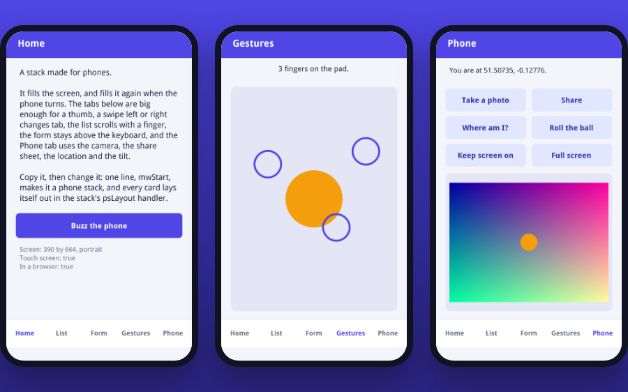

# Stacks for Phones

## Introduction

A stack built as an HTML5 standalone runs in any modern browser, and that
includes the browser of a phone or a tablet. Nothing needs installing:
the user opens a link, and the stack is there. With the Mobile Web
library, the same stack fills the phone's screen, turns with it, takes
taps, swipes, pinches and more than one finger, stays clear of the
on-screen keyboard and the notch, and uses the phone itself: its camera,
its location, its tilt, its share sheet.

The library is made to feel like xTalk. One line readies a stack, and
what happens on the phone comes to the stack as messages, by the names
LiveCode's iOS and Android engines use, sent to the control under the
finger the way mouse messages are. On a desktop the library answers as a
desktop would and sends nothing, so a stack can be made and tried in the
IDE and then built for phones without changes.



Figure 1 – The Phone Starter on a phone: its Home, Gestures and Phone cards

## Start from the Phone Starter

The quickest way in is the **Phone Starter**, in the gallery of the
Home window and in the Stack Player. It is a stack to copy: a header, a
tab bar for a thumb, and five cards that show each part of the library.

* **Home**: what the screen is, and a buzz.
* **List**: a long list that scrolls with a finger, where a tap picks a
  line.
* **Form**: fields that stay above the keyboard.
* **Gestures**: swipes, a pinch that resizes a dot, a long press, and a
  ring under each finger.
* **Phone**: a photo from the camera, the share sheet, where the phone
  is, a ball that rolls as the phone tilts, the screen kept on, and the
  browser's bars hidden.

Save a copy of it, change its cards, and keep its `psLayout` handler,
which puts every control in its place for the size of the screen.

## One line: mwStart

```
on preOpenStack
   mwStart
end preOpenStack
```

`mwStart` readies the default stack, or the stack it names, for a phone:

* A **resizable** stack fills the browser's window, and fills it again
  when the phone turns or the browser's bars come and go. It gets
  `resizeStack` each time, as on a desktop, so a `resizeStack` handler or
  the Geometry Manager lays it out.
* A stack of a **fixed size** that is too big for the window, such as one
  made for a desktop, is scaled down to fit, and taps still land on the
  controls under them. While it fits, it is left as it is.
* The gestures and the other messages below start coming.

To choose by hand, name the screen as its third parameter: `mwStart
empty, empty, "fit"`, or call `mwFillScreen` or `mwFitStack`. `mwStop`
stops it all and gives the page back its own look.

## Laying out for any screen

Phones come in many sizes, and each one turns. Lay a stack out in its
`resizeStack` handler from the size it has, not from numbers fixed when
it was made:

```
on resizeStack pWidth, pHeight
   set the rect of field "Notes" to 16, 72, pWidth - 16, pHeight - 80
   set the rect of group "Tabs" to 0, pHeight - 64, pWidth, pHeight
   pass resizeStack
end resizeStack
```

`mwViewport()` says more about the screen, as an array:

| Key | What it is |
|-----|------------|
| `width`, `height` | the part of the page that can be seen, without what the keyboard covers |
| `keyboard` | how many pixels at the bottom the on-screen keyboard covers (0 when it is down) |
| `top`, `right`, `bottom`, `left` | the safe-area insets: the pixels under a notch, a rounded corner or the home bar |
| `orientation` | `portrait` or `landscape` |

Keep buttons inside the insets, and give a short, wide screen (a phone
on its side) a layout of its own: the Phone Starter puts its form in two
columns there and makes its bars thinner.

The current card gets `orientationChanged` when the phone turns.

## Touch

A finger is the mouse. A tap sends `mouseDown` and `mouseUp`, a drag
moves the mouse, and every stack that works with a mouse works with a
finger. Make what a finger taps big enough: about 44 pixels high or
more.

Two taps close together are a double click, as on a desktop: the second
one sends `mouseDoubleDown` and `mouseDoubleUp`, not `mouseUp`. A button
that a user may tap twice quickly, such as a toggle, handles both:

```
on mouseUp
   toggleTheLight
end mouseUp

on mouseDoubleUp
   toggleTheLight
end mouseDoubleUp
```

### Gestures

After `mwStart` these come too, to the control under the finger, and on
up the message path to its group, card and stack, as a mouse message
does. A card script can handle every swipe on the card, and a control
can keep its own by handling them without passing them.

| Message | When |
|---------|------|
| `swipe pDirection` | a quick stroke of one finger: `left`, `right`, `up` or `down` |
| `pinchStart pX, pY` | two fingers touch |
| `pinch pScale, pX, pY` | they move: pScale is their distance over the one at the start |
| `pinchEnd pScale` | they let go |
| `longPress pX, pY` | a finger held still for about half a second |

```
-- in a card's script
on swipe pDirection
   if pDirection is "left" then go next card
   if pDirection is "right" then go previous card
end swipe
```

`mwLongPressed()`, asked in `mouseUp`, tells the end of a long press from
a tap.

### Every finger

For drawing, games and anything with more than one finger, each finger
sends messages of its own, to the control it touched first:

| Message | When |
|---------|------|
| `touchStart pId, pX, pY` | a finger touches |
| `touchMove pId, pX, pY` | it moves (at most once a frame) |
| `touchEnd pId, pX, pY` | it lets go |
| `touchRelease pId, pX, pY` | the browser took the touch away, as for a call |

`pId` is the same number in all of one finger's messages, so a script
can follow several at once:

```
on touchStart pId, pX, pY
   create graphic ("Finger" && pId)
   set the style of it to "oval"
   set the rect of it to pX - 20, pY - 20, pX + 20, pY + 20
end touchStart

on touchMove pId, pX, pY
   set the loc of graphic ("Finger" && pId) to pX, pY
end touchMove

on touchEnd pId
   delete graphic ("Finger" && pId)
end touchEnd
```

### Scrolling with a finger

A finger dragged over a field selects its text. To scroll a field or a
group with a finger instead, call `mwDragScroll` in its `mouseDown`: it
follows the finger, and glides on when the finger lets go. A list that
takes a tap as picking a line asks `mwDragMoved()` in its `mouseUp`, to
leave out the end of a drag:

```
on mouseDown
   mwDragScroll the long id of me
end mouseDown

on mouseUp
   if mwDragMoved() then exit mouseUp
   answer "You picked" && the value of the clickLine
end mouseUp
```

## The keyboard

A phone's keyboard covers the bottom of the screen while a field has the
focus. The current card gets `keyboardActivated` when it comes up (or
changes its height) and `keyboardDeactivated` when it goes. How much
it covers is the `keyboard` element of the array `mwViewport()` gives:

```
put mwViewport() into tScreen
set the bottom of field "Notes" to tScreen["height"] - 8
```

 Move what is being typed in above it, and when another field gets the
focus while the keyboard stays up, in `openField`, do the same: no
keyboard message comes then.

## The phone itself

| Handler | What it does |
|---------|--------------|
| `mwPickPhoto pSource, pMaxWidth, pMaxHeight` | takes a photo (`camera`, `front camera`) or picks a picture (`library`), as a new image on the card; waits for it, and `the result` is `cancel` when there is none |
| `mwStartSensor pSensor`, `mwStopSensor pSensor` | read `location`, `heading`, `acceleration` or `rotation rate`: the card gets `locationChanged`, `headingChanged`, `accelerationChanged` or `rotationRateChanged`, and `trackingError` when the user says no |
| `mwSensorReading(pSensor)`, `mwSensorAvailable(pSensor)` | a sensor's last reading, and whether the browser can read it |
| `mwShare pText, pURL, pTitle` | opens the phone's share sheet (or copies, where there is none) |
| `mwKeepAwake true` | keeps the screen on while the page is open |
| `mwFullScreen true`, `mwIsFullScreen()` | hides the browser's bars, and shows them again |
| `mwVibrate pMilliseconds` | buzzes the phone |

```
on mouseUp
   mwPickPhoto "camera", 800, 800
   if the result is "cancel" then exit mouseUp
   set the rect of last image to the rect of graphic "Frame"
end mouseUp
```

A browser keeps some of these for the user's own choice:

* The camera, the share sheet, the full screen and, on an iPhone, the
  motion sensors open **only from a tap**: call them in `mouseUp`, not in
  `openCard` or a timer.
* The location, the share sheet, keeping the screen on and the motion
  sensors need a page served over **https**.
* The browser asks the user before it gives the location (and on an
  iPhone, the motion): a no comes as `trackingError`.
* What a phone cannot do, the handler says in `the result` (`not
  supported`, `not available`), and the stack goes on: an iPhone cannot
  buzz or hide Safari's bars, for one. Called other than from a tap, the
  camera, the share sheet and the full screen say `not from a tap`.
* A stack for phones needs iOS 15 or later on an iPhone or an iPad (an
  iPhone 6s or newer), and WebAssembly: Lockdown Mode turns it off, and
  the page says so.

Stop a sensor when it is not needed, in `closeCard`: reading one uses the
battery.

## Trying it in the IDE

Every handler works in the IDE. `mwIsWeb()` and `mwIsTouchScreen()` are
false there, the gestures and sensors send nothing, `mwPickPhoto
"library"` asks for a picture file, and `mwShare` copies to the
clipboard. Make the stack a phone's size (about 390 by 760) and
resizable, and resize it to see the layout at other sizes.

## Building and putting it online

Build the stack for HTML5 (see *Deploying Your Application*). With
**Search for required inclusions** on, as it is for a new stack, the
standalone builder finds the `mw` handlers in the stack's scripts and
includes the Mobile Web library. With **Select inclusions for the
standalone application**, tick **Mobile Web Library** in the list of
extensions.

Put the standalone's folder on a web server that serves it over https,
and open its page on a phone. On an iPhone, Safari deletes what a page
keeps after some days without a visit unless the page was added to the
home screen; `mwIsInstalled()` tells whether it was, so a stack can
suggest it.
